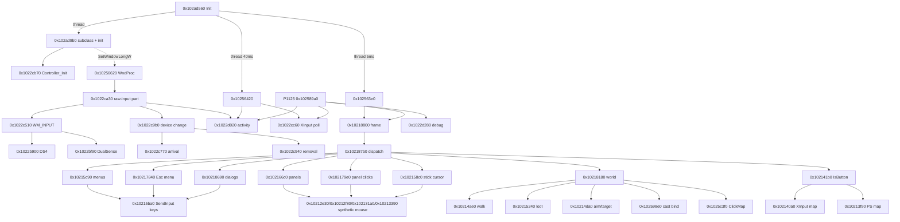

# Controller (gamepad) support in ProjectDiablo.dll

<!-- Hand-written (not generated). The other files in this folder are generated by
     tools/features/extract_feature.py from tools/features/controller.tsv; re-run the script instead of editing them. -->

PD2 lets you play Diablo II 1.13c with a gamepad. It supports Xbox-style XInput pads and Sony DualShock 4 /
DualSense pads (read as raw HID devices). The left stick walks the character. The right stick aims, and an
aim-assist search finds a target near the aim line. Ten buttons and combinations cast bound skills. Panels,
inventories, shops, waypoints, the game menu and NPC dialogs all have button navigation, and the game shows
Xbox or PlayStation button icons on screen. Almost all of it is PD2's own code in two object files (link units 1
and the block after unit 7). The game is driven mostly through direct D2Client calls, not through emulated OS input.

This README was written by hand. The member list, the call graph and the hook table are also generated
in `MEMBERS.md`. All addresses are ProjectDiablo.dll at base 0x10000000 unless a game module is named. Game names come from
`sigmaRE/5_game_source` (read-only reference), and button numbers are the logical buttons of `ControllerState.h`.

| File | Contents |
|---|---|
| `Controller.cpp` | 84 core functions, in this order: init/detect → poll/parse → map → dispatch → act → glyphs/debug |
| `ControllerShared.cpp` | 20 shared functions (threads, mode switch, UI that shows glyphs) + 14 settings functions |
| `ControllerHooks.cpp` | 21 hook handlers (5 are assembly shims Ghidra never split off, given as disassembly) + the table of 97 patch records |
| `ControllerState.h` | recovered `PadDevice` (0x63c bytes) / device list / enums / formulas; settings keys, 48 state globals, 65 strings |
| `MEMBERS.md` | generated: counts, every member with reason, member call graph, hook records with game functions, dependencies |

Copied functions keep their tree text; only the first line reads `// copy of 0x…` instead of `// 0x…`, so tools that
scan the tree for function headers (`build_patches.py`, `struct_evidence.py`) ignore this folder.

## 1. Device detection

* **Start-up.** `Init` (0x102ad560) starts a `std::thread` that runs 0x102ad9b0. That thread waits until
  `D2gfx_10048` returns the game window. It then subclasses the window (`SetWindowLongW(GWL_WNDPROC, 0x10256620)`;
  patches.csv P1600) and calls **Controller_Init 0x1022cb70**, which does the following:
  * calls `RegisterRawInputDevices` for usage page 1, usage 5 (gamepad) and usage 4 (joystick), both with flags 0x2100
    (`RIDEV_INPUTSINK|RIDEV_DEVNOTIFY`) and the game window as target;
  * allocates 4 device records of 0x63c bytes for XInput slots 0–3 (type 1) and probes each slot with `XInputGetState`.
    The device list is `{count, PadDevice*}` at `DAT_103d98ac/b0`.
* **Hot-plug.** The window subclass forwards `WM_INPUT_DEVICE_CHANGE` (0xfe) to 0x1022c9b0. That function probes the
  4 XInput slots again on every device change, then:
  * on arrival it calls 0x1022c770. Devices whose `RIDI_DEVICENAME` contains `IG_` (0x1022b800) are XInput pads and are
    skipped. Any other device gets a new record (the list only grows). The function opens the device with `CreateFileW`
    (overlapped) and reads `HidD_GetProductString` / `HidD_GetManufacturerString`;
  * on removal it calls 0x1022c940, which closes the handle and marks the record disconnected.
* **Recognised HID pads.** The device kind is set by the first report the pad sends (0x1022c510):
  * Sony DualShock 4 (VID 0x054c, PID 0x05c4/0x09cc; check 0x1022b810) is parsed by 0x1022b900 and gets type 2;
  * Sony DualSense / DualSense Edge (PID 0x0ce6/0x0df2; check 0x1022b840) is parsed by 0x1022bf90 and gets type 3.
  Other HID gamepads are registered but never parsed, so they do nothing. USB and Bluetooth reports are both handled
  (DS4 report sizes 0x40/0x223, DualSense report 0x01 (USB) and 0x31 (Bluetooth)).
* **Only one active pad.** `DAT_103d98dc` is the last device that produced input. Once it is set, polling and every query
  use only that device (0x1022cc60, 0x1022c510).

## 2. Polling, threads and frequency

| Where | When | What |
|---|---|---|
| Window subclass 0x10256620 → 0x1022ca30 → 0x1022c510 | every `WM_INPUT` (HID pads, event driven) | reads the report, parses it, writes the output report, runs activity detection |
| Frame hook **P1125** (D2Client `sub_6fb739e0+0x3d0` → 0x102589a0) | every drawn in-game frame | `XInputGetState` poll 0x1022cc60, activity 0x1022d020, then the whole dispatch 0x10218800 and edge clear 0x1022d200 |
| 40 ms thread 0x102ada30 → 0x10256420 | every 40 ms, only when there is no player unit (menus, lobby) | XInput poll and activity detection; also writes the 40 ms tick counter `DAT_103e7898` |
| 5 ms thread 0x102ada80 → 0x102563e0 | every 5 ms, when there is no player/path or D2Client byte 0x6fbbf2f3 == 1, and controller mode is on | dispatch 0x10218800 + edge clear; also writes the 5 ms tick counter `DAT_103e7890` |

Out of game, the threads call the game's UI and message functions from PD2's own threads, not from the game thread.
**Activity detection** (0x1022d020) runs over the 64 value slots of the active device:
* a button slot that changed sets its `changed[]` flag and counts as input when it is now non-zero;
* a stick slot counts as input when `|v| >= dead zone`.

When it finds input, controller mode is turned on (`DAT_103d9867 = 1`) and every input state is reset (0x10256150).
**Back to mouse mode** happens in four cases:
* 40 `WM_MOUSEMOVE`/`WM_TOUCH`/`WM_GESTURE` messages in a row (`DAT_103d98d4 > 39`; every controller action resets
  the counter);
* a real left or right click. PD2's own synthetic clicks set `DAT_103d5ee3` so that they don't count;
* WASD movement (0x10236e90);
* turning `controller_movement` off.

Leaving controller mode re-centres the OS cursor (`SetCursorPos(screen/2)`, 0x10218890).

## 3. Values, dead zone and curves

Each device keeps `float cur[64]`, `prev[64]` and `changed[64]` (struct in `ControllerState.h`). The values are as follows:
* buttons are 0 or 1;
* analog triggers become 1 at ≥ 0.3;
* each stick axis is stored as −v and +v. XInput uses `sThumb/32767`; DS4 and DualSense use `byte/255·2−1`. The PS
  D-pad comes from the hat nibble.

The **logical buttons** 0–15 are A, B, Y, X, D-pad Left/Right/Up/Down, LB, RB, Back, Start, LT, RT, L3, R3. They are
mapped per kind by 0x102140a0 (XInput) and 0x10213f90 (PlayStation: Cross, Circle, Triangle, Square, …, Touchpad
click = Back, Options = Start). The same number is the frame in the glyph sheets. Queries:
* `IsButton(btn, mode)` 0x102141b0, with modes 0 pressed, 1 held and 2 released;
* `StickDirection(dir, stick)` 0x10214210, true when the stick is outside the dead zone and the half-axis is > 0.7;
* `StickIdle(stick)` 0x102143b0, a square dead zone.

| Quantity | Formula (address) |
|---|---|
| dead zone, XInput | `(controller_deadzone − 20)·0.01 + 0.4` (0x10214350), so 0.2–0.6 and 0.4 by default |
| dead zone, DS4/DualSense | `(controller_deadzone − 20)·0.01 + 0.3`, so 0.1–0.5 and 0.3 by default |
| stick vector | 0x10214430. Each axis is linearly re-mapped from [dz, 1] to [0, 1] and scaled; then radial curve `v/|v|·|v|^1.3`. Axes below dz/3 are dropped |
| cursor speed | `(controller_sensitivity − 50)·0.04 + 4` px per 5 ms tick, so 2–6 (0x102158c0) |
| walk target | player position + left-stick vector·10·0.5, rotated −45° into the isometric grid (0x10214600) |
| aim assist | 0x10214da0. With the right stick pushed, it probes points along the stick at distance d = (2−aim)·3, +3, … < 14, with search radius `d/4 − 2·(2−aim) + 5`. With the right stick idle, it takes the nearest target round the player (0x1025c7c0), or else probes along the left stick with radius `d/4 + 2·aim + 2` |

## 4. Button map (fixed; no remapping)

Button assignments are hard-coded; only the 10 skill binds are user data. These tables come from the 127 `IsButton`
call sites, with arguments recovered from the disassembly (Ghidra lost the register arguments). The `patchstring.tbl`
help texts (`ControllerSkillSelect1–12`, `ControllerHelpInventory*`, `ControllerKeybind*`) confirm them.

**In the world** (dispatcher 0x10218180, reached through 0x102187b0 when no panel handler takes the input):

| Input | Action | Address / game call |
|---|---|---|
| Left stick | walk (repeats every 5 × 40 ms). Calls `D2Common_10286` (PATH/Path.cpp), `D2Common_10336`, `D2Common_10334` and `UNIT_UnitMode_6fada6c0` directly; no click emulation | 0x10214ae0 |
| Right stick | aim direction for target selection | 0x10214da0 |
| A, B, Y, X, RB | cast bind 1–5. With LT held, binds 6–10. Binds live in PlayerData+0x512 (16 × 8 bytes); cast through 0x102598e0 | 0x10215e50 → 0x10215d20 |
| A on an object/NPC/item/waypoint | interact through the ClickMap wrapper 0x1025c3f0 (D2Client `sub_6facbf20` = ClickMap) | 0x10218180 |
| RT (held) | attack with the right skill at the target unit or point | 0x10218180, 0x10217f60 |
| LB (held) | show loot: each nearby ground-item label gets a button (A, B, Y, X, RB, D-pad L/U/D/R); pressing it picks the item up (ClickMap). With `controllerMultiButtonLoot`, up to 48 labels with a two-press group selection | 0x10215240, glyphs 0x10257d50 |
| LT + LB | toggle BH "always show items" (`BHSetConfig(9, …)`) | 0x10218180 |
| D-pad L/U/D/R | use belt column 1–4. With LT held: give the potion to the mercenary (Shift flag) | `sub_102f0b10` → D2Client `sub_6fad9990` |
| L3 | automap (D2 key command 7, D2Client `sub_6faeb8b0`) | 0x10218180 |
| LT + L3 | toggle run/walk (key command 35, `sub_6fae9c60`) | 0x102166c0 |
| R3 | weapon swap (`UI_inv_6fb40f60` through 0x1022b130) | 0x10218180 |
| LT + R3 | resync (PD2 packet, 0x1022ac80) | 0x102166c0 |
| Start | close BH advanced stats if open (`BHGetConfig(17)`/`BHInteract(1)`), close panels, then send `VK_ESCAPE` to PD2's key handler, which opens the game menu | 0x102166c0 |
| Back | open the inventory (key command 1, `sub_6faec2a0`). With panels open it closes them | 0x102166c0 |

**Panels** (0x102166c0, 0x102179e0). While a panel or menu owns the cursor, the left stick moves it (0x102158c0). It
writes D2Client MouseX/MouseY directly and sends a synthetic `WM_MOUSEMOVE` to the D2Client and PD2 handlers of the
open panel (0x10212e30); the OS cursor does not move.

| Input | Action |
|---|---|
| A / X | left / right click (synthetic `WM_LBUTTONDOWN/UP`, `WM_RBUTTONDOWN` sent to the handler of each open panel: 0x10212f80, 0x102131a0, 0x10213390) |
| LT / RT / L3 held | Shift / Ctrl / Alt modifiers of that click (MK flags 4, 8, 0x20; PD2's right-click handler 0x1022ec90 accepts 0x20 in place of Alt) |
| B | close (0x1022b140; also closes BH advanced stats) |
| Y | open the cube / Repair All (repair NPC) / Refresh (gambling) / BH advanced stats (character screen) |
| LB / RB | cycle the panel ring Party, Quest, Character, Inventory, Skills, Hireling, Hotkeys (bar drawn by 0x10257dd0). Party is skipped without a party, Hireling without a mercenary. Panels open through D2's own key-command handlers (D2Client command table 0x6fba4f10: Character 0, Inventory 1, Party 2, Quest log 4, Skill tree 12, Skill speed bar 13, Hireling 54) |
| LB / RB with the stash open | stash page −/+ (PD2 packet 0x55, 11 pages, `DAT_104dbf3c`) |
| LB / RB in a shop or the waypoint menu | shop tab (`UI_inv_6fb3f710`) / waypoint act tab |
| B, A, X, Y, D-pad L/U/D/R, RT, LT in the waypoint menu | B closes. The other nine pick waypoint rows 1–9 (packet 0x49, sound 0x8b7) |
| D-pad (with auto-repeat 250 ms, then 75 ms) | move the cursor cell by cell in the inventory/stash/cube/shop grid, skipping empty space (0x10216190) |
| Right stick left/right | jump between the inventory grid and the stash/cube/shop grid |
| Skill speed bar (Hotkeys) open | hover a skill and press A, B, Y, X or RB (or LT + one of them) to bind it (packet 0x43 with slot, skill and left/right flag; 0x10215fb0). RT clicks, which assigns the right skill |
| Esc menu (0x10217840) | D-pad Up/Down and D-pad or left stick left/right go to the D2Client menu key handlers (`sub_6fb14f50/ee0/e00/d20` with VK 0x28/0x26/0x25/0x27); A = Enter, B = Esc (`SendInput`) |
| NPC dialogs (0x10218690) | D-pad Up/Down = arrow keys, A = Enter, B = Esc (`SendInput`) |
| Out of game (0x10215c90) | A = OS left click (`SendInput`), B = Esc, D-pad = arrow keys |

Stat and skill point buttons (hooks P1123/P1124 → 0x102e43a0/0x102e4480) treat LT as Shift and RT as Ctrl
(5 / 20 / all points).

## 5. How it drives the game

* **Direct D2Client calls** for nearly everything. Cursor moves write `MouseX/MouseY` and send synthetic mouse messages to
  the per-panel message handlers. Walking uses the path functions. Interaction and pickup go through ClickMap. Panels
  open through the command table, and packets go out through `sub_6fac43e0`.
* **`SendInput`** is used only for key taps (0x10215ba0: VK down/up for Enter, Esc and arrows; the call passes 4 INPUTs,
  of which the last two are zeroed no-op mouse entries) and for real left clicks while there is no player
  (`MOUSEEVENTF_ABSOLUTE|LEFTDOWN/UP` at the game's MouseX/MouseY in pixels, not the 0–65535 range ABSOLUTE expects).
* **`SetCursorPos`.** PD2 calls Win32 `SetCursorPos` directly only when controller mode ends (0x10218890). Out of
  game (no player unit), 0x10212e30 moves the real cursor through the game's own SetCursorPos wrapper (D2Client
  `sub_6fac61b0`, through 0x102f08a0). While the mode is on, PD2 **suppresses all 21 calls the game itself makes
  to that wrapper**. The calls are redirected through shim
  0x102f08c0 → 0x1025d170 (main-table entries 1349–1369).
* **Cursor ownership.** In controller mode the cursor-draw calls (`sub_6fac6a90`, entries 2107–2112 → 0x1025c4c0 →
  0x10215760) work as follows:
  * if an item is on the cursor, they draw it;
  * otherwise they park the cursor at (115, 547) and switch D2GL's cursor drawing off (`d2glConfigSetImpl(9 DRAW_CURSOR, 0)`,
    `(2 HD_CURSOR, 1)`). The saved position comes back when a panel opens or the mode ends (0x10213480).
* **`GetAsyncKeyState`** is not used by the controller. The two calls in the area (0x10259590, 0x1022ec90) are the
  keyboard paths that the controller replaces with `IsButton` / MK flag 0x20.

## 6. On-screen UI

* **Glyph sheets.** They are loaded by 0x1022b730 from `pd2assets.mpq` (`data\global\ui\CONTROLS\Controls_{Xbox,Dualshock}_{10,20}.dc6`,
  `controllercrosshair.dc6`, `PANEL\controllermenu.dc6`, `PANEL\controllerhelp.dc6`). `controller_button_style` picks the
  set: 0 follows the kind of the active pad, 1 is Xbox, 2 is PlayStation. Glyphs appear:
  * on the interact target (0x10257cb0);
  * on loot labels (0x102150b0/0x10257d50);
  * on skill icons and the skill bar (0x10225a60 via entries 2113–2116, 0x102574e0);
  * on belt slots (0x10226280);
  * on the stash tabs as LB/RB (0x10226880);
  * on the panel bar and the help pages (0x10257dd0 → 0x10213620);
  * in item hover text (0x10220830).
* **Options menu entries.** There are 0x550-byte records in .data: ControllerMovement 0x1039b01c, Sensitivity,
  AimAssist, Deadzone, ControllerMultiButtonLoot, and MenuControllerBtns (Auto / MenuXbox / MenuPS). Each has a setter
  (+0x108) and a getter (+0x10c), in `ControllerShared.cpp`. The three tuning entries are only visible while
  `controller_movement` is on (0x10230f20). The labels are DC6 images; the D2GL fork maps them to HD text
  (`d2gl/src/modules/hd_text/variables.h`, commit fbd168a).
* **Debug overlay.** The chat command `.debugcontroller` sets `DAT_104dbb08`. The frame hook then draws 0x1022d280: device
  kind ("Xbox/XInput", "PS4/Dualshock", "PS5/Dualsense"), all values, and the cursor position.

## 7. Vibration, lightbar and adaptive triggers

The code to drive all three exists, but it never does anything. `XInputSetState` is called on every poll with
`wLeftMotorSpeed = PadDevice+0x54c·65535` and `wRightMotorSpeed = +0x550·65535`. The DS4 and DualSense output reports
are written after every input report, with both motor bytes, the lightbar, and (DualSense) two adaptive-trigger
effects encoded by 0x1022bd90. No code writes the rumble, lightbar-green/blue or trigger fields; the only stores are
`+0x554 = 0.3` (red) at 0x1022bcbb/0x1022c45e. So the motors are always 0, a Sony pad's lightbar is dim red (0x4c,0,0),
and the triggers are off.

## 8. Settings (`ProjectDiablo.json`, `/pd2_game_settings/…`; see `6_config/ProjectDiablo.json.md`)

| Key | Global | Default | Range | Effect (reader) |
|---|---|---|---|---|
| `controller_movement` | 0x104e24ca | true | bool | Master switch. Off means no XInput poll in game, `WM_INPUT` ignored and controller mode forced off (0x102589a0, 0x1022ca30, 0x10256420). Raw input is still registered at start-up |
| `controller_sensitivity` | 0x104e24cc | 50 | 0–100 | cursor speed (0x102158c0) |
| `controller_aim_assist` | 0x104e24dc | 1 | 0–2 | aim search radius (0x10214da0) |
| `controller_deadzone` | 0x104e24ec | 20 | 0–40 | dead zone (0x10214350). `6_config` lists only the menu getter as reader |
| `controller_button_style` | 0x104e2514 | 0 | 0 auto, 1 Xbox, 2 PS | glyph set (0x1022b730, 0x10220830) |
| `controllerMultiButtonLoot` | 0x104e2524 | false | bool | 9 or 48 loot labels (0x10215240) |

The defaults are set in 0x102ac5e0 (slider maxima 100/2/40 at 0x104e24d8/e8/f8). The settings are loaded by 0x1023b445
and saved by 0x10239e00 (generic settings code, so they are dependencies).

## 9. Hooks

97 patch records (table in `ControllerHooks.cpp`, full list in `MEMBERS.md`):

| Records | Site (D2Client) | Handler | Purpose |
|---|---|---|---|
| P1600 (W-0001) | game window procedure | 0x10256620 → 0x1022ca30 | `WM_INPUT`, device change, focus, mouse-activity mode switch (shared with PD2 mouse/keyboard handling) |
| P1125 | `sub_6fb739e0+0x3d0` (call of `sub_6fb02d90`) | 0x102589a0 | in-game poll + dispatch every frame (shared with DPS text, WASD, hold-to-cast) |
| P1129 | `sub_6fb739e0+0x380` (`UI_showitems_6fb08fb0`) | 0x10258980 → 0x10257d50 | loot-label glyphs |
| P1126, P1127 | `sub_6fb6f0d0+0x12`, `sub_6fb739e0+0x1db` | 0x10256f90/0x10256fa0 → 0x10258240/0x10258280 | HUD passes; add the target glyph, panel bar and help in controller mode |
| P1123, P1124 | stat/skill buttons | 0x102ed850/0x102ed860 | LT/RT as Shift/Ctrl |
| P1238, P1239 (cond. table) | `sub_6fb739e0+0x138/+0x14a` | 0x10227d70 | stash UI (LB/RB tab glyphs) |
| rt 1349–1369 (21) | every call of the game SetCursorPos `sub_6fac61b0` | shim 0x102f08c0 → 0x1025d170 | suppressed in controller mode (controller only) |
| rt 2100–2105 (6) | ClickMap calls in `sub_6faf4230/46b0/4880` | 0x1025c3f0 | ClickMap wrapper (WASD + controller) |
| rt 2106 | `sub_6fb739e0+0x78` (`sub_6fb70d30`) | 0x1025c4a0 | remembers the target's screen position (controller only) |
| rt 2107–2112 (6) | cursor-draw calls (`sub_6fac6a90`) | 0x1025c4c0 | controller cursor drawing / parking |
| rt 2113–2116 (4) | skill-icon label calls in `sub_6faee490/5e0` | shims 0x102f0950/0x102f0990 | button glyphs on skill icons (controller only) |
| rt 1412–1427 (16), 1996–2027 (32), 2033, 2035 | skill hotkey commands, hotkey text, belt, hover text | shims 0x102ee6a0/0x102f0450, 0x10226280, 0x10222470 | shared UI with controller variants |

**`rt N`** is entry N of the main patch table 0x103c7f50. Only entries 0–1197 are initialised data in the file. The
static initializer 0x100f3330 builds entries 1198–2185 byte by byte at load time (before DllMain installs the table),
so `patches.csv` (1,198 main-table rows) does not contain them. `extract_feature.py` emulates that initializer to decode
the controller's entries. 32 of the 97 records exist only for the controller: 1349–1369, 2106, 2107–2112 and
2113–2116; the rest are shared.

`5_game_patches/FEATURES.md` now has a `controller` section. It holds P1125, moved from `skills` by
`tools/patches/overrides.tsv`, and links to this package.

## 10. Call graph (condensed; `MEMBERS.md` has every edge)



## 11. Members and dependencies

There are 139 member functions: 84 core, 20 shared, 14 config and 21 hook. The other members are 97 hook records
(18 manifest rows), 48 state globals, 6 settings keys and 65 strings, plus 32 dependencies that are listed but not
copied. The dependencies are:
* generic wrappers: send packet `0x102ed200`, `GetUiVar` `0x102edf00`, load cel `0x102edee0`;
* the tick-counter atomics;
* the BH exports `BHGetConfig/BHSetConfig/BHInteract` (`0x10231650/0x10231680/0x102316b0`);
* D2GL `d2glConfigSetImpl` (`0x10231ae0`);
* WASD and hold-to-cast helpers;
* the ground-item label builder `0x10223f90`;
* the settings loader and writer;
* STL helpers.

Confidence is `medium` for the 12 functions of the `std::sort` instance that only the loot comparator uses, and for a
few shared hooks; everything else is `high` or `low` with a reason in the manifest. Link unit 1 (code 0x10212e30–0x102194c0) is the
controller's game-side object file. Apart from STL instances shared with other files, all of its code is controller
code. The device layer is the block 0x1022b720–0x1022da00 after unit 7; its first eight functions (0x1022b450–0x1022b6e0)
are stash-page buttons that send packet 0x55, not controller code. The module scan (link unit 45) does not touch any
controller state.

**Not part of the feature:** BH.dll (only provides the config and interact exports used above), D2GL (cursor flags
and the HD-text mapping of the menu labels), and the launcher (no controller settings or code).

## 12. Uncertain or not recovered

* **Command-table indices.** The names of D2 key commands 35 (run/walk) and 54 (hireling) come from the table position
  and PD2's help strings. The reference tree has no names for the D2Client command table 0x6fba4f10.
* **Packet 0x43.** The bind packet (10 bytes: slot, skill, left/right flag, owner) and the PlayerData+0x512 bind table
  are PD2 additions inferred from use; the server side was not traced.
* **`D2Client 0x6fbbf2f3`.** It gates the out-of-game dispatch together with "no player path". Its meaning is unknown.
* **Raw `WM_INPUT` handling.** It calls `DefWindowProcW` itself (0x1022ca30) and then the subclass goes on to
  `CallWindowProcA` for some messages. Whether that double handling matters was not checked (no run).
* **`controllercrosshair.dc6`.** It is loaded, but no draw call for it was found.
* **Lost XMM arguments.** Ghidra dropped the XMM arguments and returns (dead zone, curve) and the register arguments of
  `IsButton`. The formulas and button numbers above come from disassembly, so the decompiled text of those call sites
  shows `sub_102141b0(0)` without the button.
* **patches.csv errors.** P1600 names `D2gfx_10048` (the HWND getter) as the handler; the real new window procedure is
  0x10256620. `patches.csv` also lacks the 988 runtime-built main-table entries (section 9).

## Re-running

```
python3 -I tools/features/extract_feature.py tools/features/controller.tsv [--repo /home/user/fd2] [--work /home/user/fd2_work]
```

Inputs, all read-only:
* the manifest and `tools/features/controller_state.h.in`;
* the generated tree (`4_pd2_source/ProjectDiablo`: `.cpp`, `symbols.csv`, `include/globals.h`);
* `5_game_patches/patches.csv`;
* `fd2_work/bin/ProjectDiablo.dll`;
* the shipped game DLLs and `sigmaRE/5_game_source`, used to name the runtime table entries.

It rewrites every file in this folder except this README and exits non-zero if the manifest disagrees with the
binary or the tree (missing function text, missing patch record, string mismatch). After `tools/rebuild.sh --pd2`
re-run it so that the copied text matches the tree. `tools/patches/build_patches.py` regenerates `FEATURES.md`
(controller section from `tools/patches/features.json` + `overrides.tsv`).
